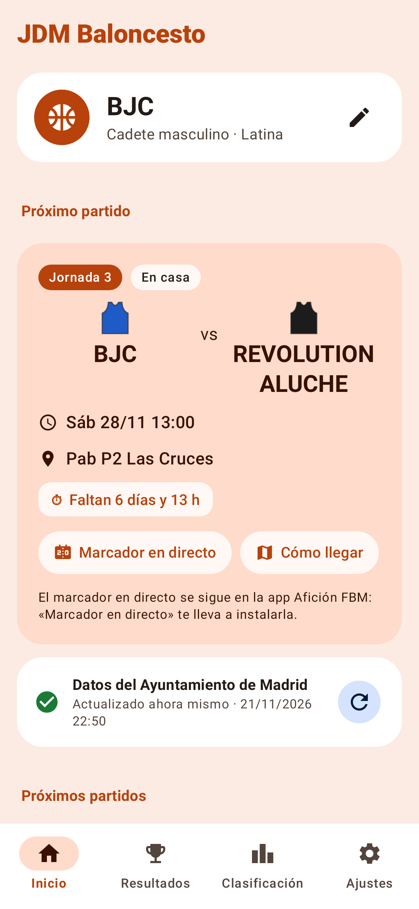
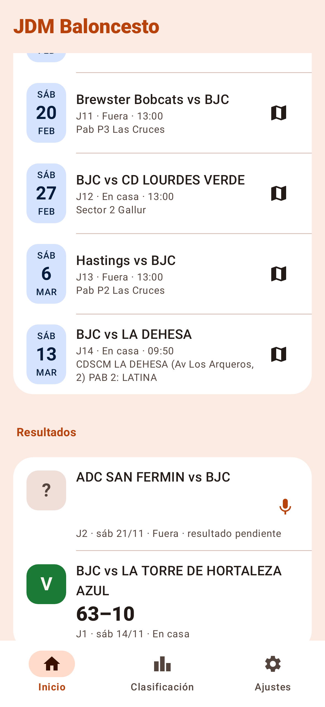
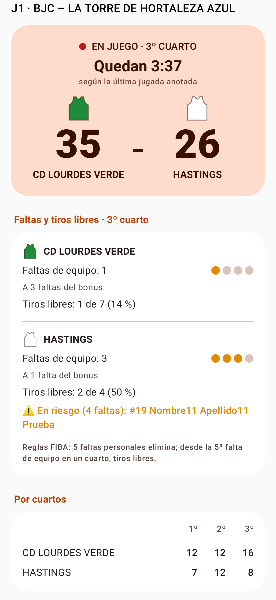
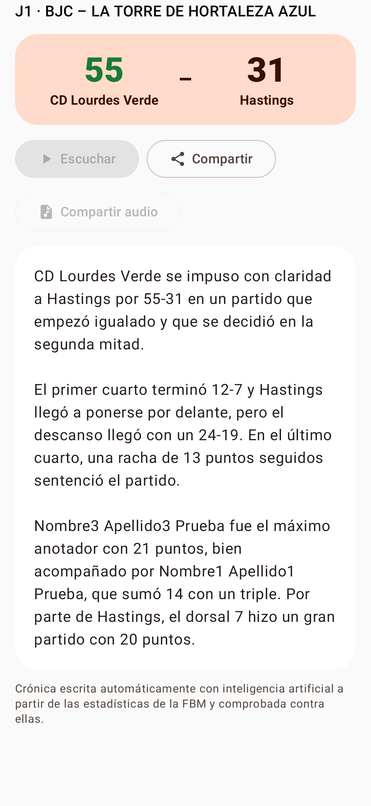
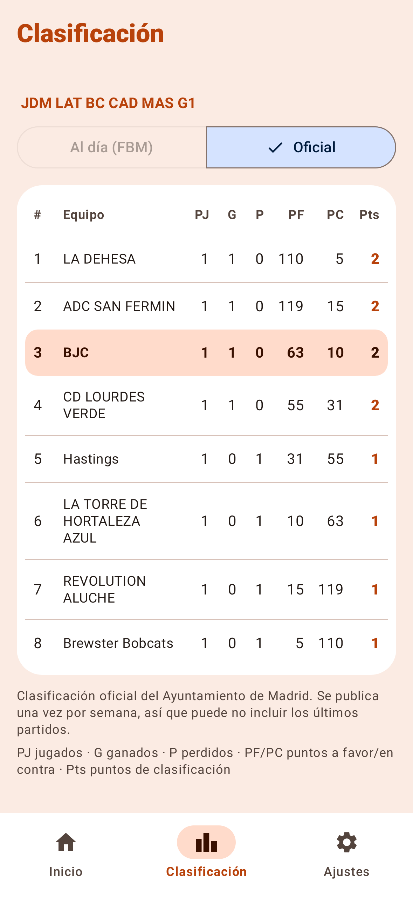

# 🏀 JDM Baloncesto

App para Android que sigue los partidos de un equipo de baloncesto de los **Juegos Deportivos
Municipales (JDM) de Madrid**. Es una app personal hecha por un padre: no es oficial ni del
Ayuntamiento ni de la Federación de Baloncesto de Madrid.

**[⬇️ Descargar la última versión](https://github.com/amiguelp/jdm-baloncesto/releases/latest)**:
en esa página, en *Assets*, el archivo `jdm-baloncesto-vX.Y.Z.apk`.

## Qué hace

- **Próximos partidos** del equipo (fecha, hora, pabellón, «Cómo llegar») y pestaña **Resultados**, con el
  ganador en verde.
- **Avisos** cuando cambia la hora o el pabellón de un partido, cuando se anula o cuando hay resultado,
  y recordatorios la víspera y un rato antes de cada partido (en tu calendario o, si no lo usas, como notificación).
- **Camisetas** con el color de cada equipo (el del acta del partido en cuanto la mesa lo apunta).
- **Marcador en directo** durante el partido: tanteo, cuarto, tiempo, jugadas, puntos de cada jugador,
  faltas (con aviso de jugadores con 4 o 5 faltas y de bonus) y tiros libres.
- **Retransmisión** del partido y grabación, cuando el Ayuntamiento lo emite (pabellón de Las Cruces).
- **🎙️ Crónica** de cada partido poco después de terminar: para leer, escuchar con la voz del móvil y
  compartir por WhatsApp.
- **Clasificación** al día (con los resultados de la Federación) y la oficial del Ayuntamiento; al tocar un
  equipo, sus partidos jugados y los que le quedan, con la grabación de los que emite el Ayuntamiento.
- **Calendario** opcional: un evento por partido en tu calendario.
- **Se actualiza sola**: cuando hay versión nueva, la app lo avisa y se instala con dos toques.

| Inicio | Resultados | Marcador en directo | Crónica | Clasificación |
|---|---|---|---|---|
|  |  |  |  |  |

## Cómo instalarla

La app no está en Google Play: se instala con el archivo APK.

1. En el móvil, abre el enlace **[Descargar la última versión](https://github.com/amiguelp/jdm-baloncesto/releases/latest)**
   y toca `jdm-baloncesto-vX.Y.Z.apk` en *Assets*.
2. Abre el archivo descargado (desde la notificación de descarga o desde *Archivos → Descargas*).
3. Si Android pide permiso para **instalar aplicaciones desconocidas** desde el navegador o desde
   *Archivos*, actívalo y vuelve atrás.
4. Si **Google Play Protect** avisa de que es una app desconocida, toca **Más detalles → Instalar de
   todos modos**. Sale porque la app no viene de Google Play y la usan pocas personas.
5. Abre la app y sigue los pasos de bienvenida: elige tu equipo (por distrito, categoría y nombre) y si
   quieres los partidos en tu calendario.

**Móviles con Family Link (control parental):** el padre o la madre tiene que permitir la instalación
desde la app Family Link de su móvil (*Controles → Apps*), o instalarla desde el móvil del menor con
el permiso del adulto.

## El calendario

Si quieres, la app guarda cada partido como un evento en **tu** calendario: el de tu cuenta de Google (lo
verás también en el ordenador) o uno solo del móvil. Los cambios de hora o pabellón se actualizan solos.
Si no lo quieres, marca **«No usar calendario»** al instalarla o en *Ajustes → Calendario*: seguirás
recibiendo los avisos, el marcador y las crónicas.

## Batería

Para que los avisos lleguen a su hora, en *Ajustes → Batería* de la app toca **«Permitir»** (o, al instalarla, en «Segundo plano»)
(o en los ajustes del móvil: *Aplicaciones → JDM Baloncesto → Batería → Sin restricciones*). La app solo
se despierta unos segundos al día; no gasta batería apreciable.

## Privacidad

- La app **no tiene cuentas ni recoge datos**: no envía nada sobre ti ni sobre tu móvil a nadie.
- Lee datos públicos: el calendario y la clasificación de los JDM (datos abiertos del Ayuntamiento de
  Madrid), el marcador y las estadísticas de la Federación de Baloncesto de Madrid (los mismos que la app
  oficial «Afición FBM») y las retransmisiones del portal del Ayuntamiento.
- Los **nombres de los jugadores** vienen de la Federación y solo se ven dentro de la app.
- Las **crónicas** se escriben con inteligencia artificial a partir de las estadísticas y se publican
  en este repositorio **sin nombres**, solo con dorsales; cada móvil pone los nombres al mostrarla.
- Si das permiso de calendario, la app solo crea y cambia los eventos que crea ella.

## Preguntas frecuentes

**¿Qué equipo sigue?** El que elijas al instalarla (se cambia en *Ajustes → Equipo*).
Las crónicas solo se escriben para los equipos que tiene configurados el autor: si quieres la de otro
equipo, pídeselo.

**No me llega la crónica.** Se escribe en cuanto la Federación da el partido por terminado y la app la
busca cada 10 minutos después del partido. En la pestaña *Resultados*, el botón 🎙️ del partido y *Buscar ahora*.

**La clasificación «Oficial» no tiene el último partido.** El Ayuntamiento la publica una vez por semana.
Usa «Al día (FBM)».

**¿Cómo la desinstalo?** Como cualquier app. Si escribía en un calendario, antes puedes usar
*Ajustes → Calendario → Borrar calendario y regenerar* o borrar el calendario.

---

Las versiones nuevas y las crónicas se generan automáticamente con GitHub Actions en este repositorio.
El código de la app está en un repositorio privado.
